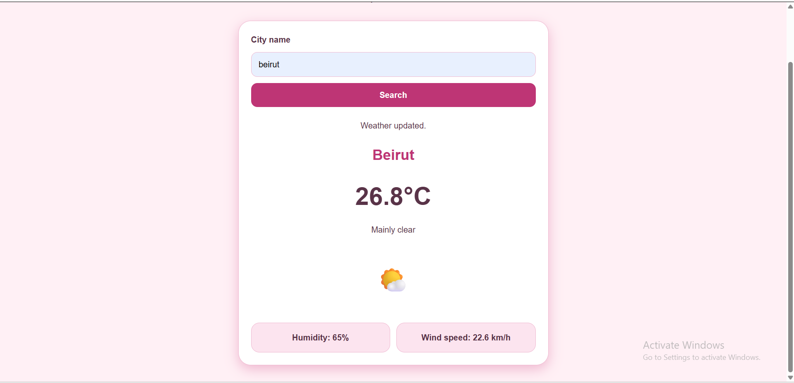

# Assignment 4 — Weather Dashboard

A responsive weather dashboard built with HTML, CSS, and vanilla JavaScript.

## API and API-Key Setup

This project uses Open-Meteo, the API demonstrated in Chapter 11.

No API key or account is required for this setup.
You do not need to obtain a key, create a .env file, or change the code.

The app first finds the city's coordinates using the Geocoding API,
then requests current weather using the Forecast API.

- Documentation: https://open-meteo.com/en/docs
- Geocoding documentation: https://open-meteo.com/en/docs/geocoding-api

No API keys are included in the repository.
.env files are excluded through .gitignore.

## Project Files

- index.html — page structure and search form.
- style.css — styling and responsive layout.
- js/api.js — city and weather requests.
- js/render.js — messages, weather descriptions, icons, and results.
- js/main.js — form submission and application flow.

## Manual Checks

- Successful city searches and replacement of previous results.
- Search using the Enter key.
- Unknown city and spaces-only input.
- Offline error message and recovery.
- Loading message and disabled Search button on a slow connection.
- Layout at mobile and desktop widths.
- No uncaught JavaScript errors on page load or successful searches.

## Data Attribution

Weather data provided by Open-Meteo: https://open-meteo.com/
## Screenshot

